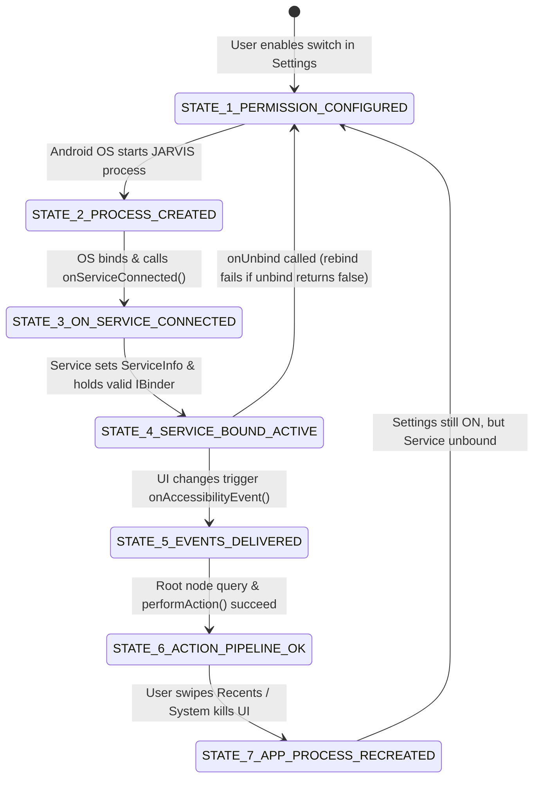

# JARVIS Accessibility Service — Root Cause Diagnosis & Recovery Architecture

**Generated Date:** November 9, 2026  
**Target Component:** `com.jarvis.assistant.automation.accessibility.JarvisAccessibilityService`  
**Configuration File:** `app/src/main/res/xml/accessibility_service_config.xml`  
**Manifest Declaration:** `app/src/main/AndroidManifest.xml`  

---

## 1. Problem Statement & User Symptoms

The confirmed user symptom is as follows:
- The Android Settings Accessibility toggle for JARVIS remains **ON** (enabled in `Settings.Secure.ENABLED_ACCESSIBILITY_SERVICES`).
- Following a phone reboot, or after swiping JARVIS away from the Recent Apps overview, the accessibility automation stops responding.
- Re-opening JARVIS does not restore automation commands.
- The user is confused because the Settings switch is still visibly ON, yet JARVIS reports or behaves as if accessibility is non-functional or dead.

---

## 2. Definitive Diagnosis: The Seven Discrete States

A critical flaw in the original design was treating "Accessibility Permission Enabled" and "Accessibility Service Operational" as a single boolean (`instance != null` or `Settings.Secure` string presence). In modern Android (API 26 through API 34), an accessibility service transitions through **seven distinct, non-interchangeable states**:



### Detailed Breakdown of the Seven States:

| State | Definition | How to Verify Truthfully | Failure Mode in Original Code |
|---|---|---|---|
| **State 1: Permission Configured** | User turned switch ON in Android Accessibility Settings. Service package/class is present in `Settings.Secure.ENABLED_ACCESSIBILITY_SERVICES`. | Query `Settings.Secure.getString(contentResolver, ENABLED_ACCESSIBILITY_SERVICES)`. | App assumed State 1 implies State 4 & 6. When the service died, State 1 stayed true while the service was dead. |
| **State 2: Process Created** | The Linux process hosting `JarvisAccessibilityService` is running. | `Process.myPid()`, checking if Application class initialized. | Swipe from Recents or OEM task killing kills the process. State 1 remains true in system settings. |
| **State 3: onServiceConnected() Called** | Android's `AccessibilityManagerService` successfully bound the service and delivered the lifecycle connection hook. | Track boolean `isConnected` set in `onServiceConnected()`. | Service called `ensureJarvisServiceActive()`, which on Android 14 crashed if microphone foreground service restrictions were triggered. |
| **State 4: Service Bound & Active** | The service holds an active IPC binder connection to `AccessibilityManagerService`. | Service has not received `onUnbind(Intent)`. | Service did not override `onUnbind(Intent)`. Default returned `false`, disabling future rebinds! |
| **State 5: Events Delivered** | The service is receiving window and node changes. | Track `lastEventTimestamp` and `eventCounter`. | Config XML only declared `typeWindowStateChanged|typeWindowContentChanged`. Notifications, clicks, scrolls were lost! |
| **State 6: Action Pipeline Operational** | Queries like `rootInActiveWindow` return valid non-null `AccessibilityNodeInfo` hierarchies. | Active root query test with error detection. | When `instance == null`, callers silently returned null or failed without diagnostics. |
| **State 7: Process Recreated** | The UI process was recreated after death, while accessibility service may or may not be re-bound by OS. | Diagnostic handshake between Activity and Service. | Activity had no way to know if service was binding or dead; showed false "Granted" status. |

---

## 3. Root Cause Analysis

### Root Cause 1: Lack of `onUnbind` and `onRebind` Overrides
In Android, when an accessibility service is unbound by the system (e.g. during heavy memory pressure, user swiping the app from recents, or screen off battery management):
- The OS calls `onUnbind(intent: Intent?): Boolean`.
- By default, `Service.onUnbind` returns `false`.
- When `false` is returned, Android will **never call `onRebind(intent)`** when the client attempts to reconnect!
- Furthermore, `JarvisAccessibilityService` only cleared `instance` in `onDestroy()`. If Android unbound the service without immediately destroying the service object, `instance` remained non-null, pointing to a disconnected zombie service where all subsequent `rootInActiveWindow` queries threw dead-object exceptions.

### Root Cause 2: Inadequate XML Configuration
In `app/src/main/res/xml/accessibility_service_config.xml`:
```xml
<accessibility-service xmlns:android="http://schemas.android.com/apk/res/android"
    android:description="@string/accessibility_service_desc"
    android:accessibilityEventTypes="typeWindowStateChanged|typeWindowContentChanged"
    android:accessibilityFeedbackType="feedbackGeneric"
    android:notificationTimeout="100"
    android:accessibilityFlags="flagDefault|flagRetrieveInteractiveWindows|flagReportViewIds"
    android:canRetrieveWindowContent="true"
    android:canPerformGestures="true"
    android:canTakeScreenshot="true" />
```
- **Missing Event Types**:
  `JarvisAccessibilityService.kt` line 240 explicitly listens for:
  `if (event.eventType == AccessibilityEvent.TYPE_NOTIFICATION_STATE_CHANGED)`
  to auto-extract incoming OTPs from SMS/WhatsApp notifications. But `accessibilityEventTypes` in the XML omitted `typeNotificationStateChanged`! It also omitted `typeViewClicked` and `typeViewScrolled`.
- **Missing Flags**:
  `accessibilityFlags` omitted `flagIncludeNotImportantViews`. Modern Android UI toolkits (Jetpack Compose, Flutter, WebView-heavy apps like Google Play or Banking apps) mark interactive nodes as "not important for accessibility" unless `flagIncludeNotImportantViews` is explicitly declared. Without this flag, node searches fail to locate input boxes, buttons, and text fields.

### Root Cause 3: Zero Boot Recovery Hook
The project has **no `BootReceiver`** declared in `AndroidManifest.xml` and does not hold `android.permission.RECEIVE_BOOT_COMPLETED`.
When an Android device restarts:
1. Android boots into Direct Boot mode (device encrypted). Third-party apps cannot access credential-encrypted storage until first user unlock.
2. After first unlock, Android OS broadcasts `ACTION_BOOT_COMPLETED`.
3. If an app does not handle this broadcast, its process remains cold until the user taps the launcher icon.
4. On many OEM devices (Xiaomi HyperOS, MIUI, Vivo FunTouch, Oppo ColorOS), the accessibility framework delays binding third-party accessibility services until the app process receives a system broadcast or is launched.

### Root Cause 4: Android 14 Background Foreground-Service Start Restriction
In `JarvisAccessibilityService.onServiceConnected()`:
```kotlin
override fun onServiceConnected() {
    super.onServiceConnected()
    instance = this
    Log.i(TAG, "JarvisAccessibilityService connected and active")
    ensureJarvisServiceActive()
}
```
`ensureJarvisServiceActive()` called:
```kotlin
val intent = Intent(this, JarvisConversationService::class.java).apply {
    action = JarvisConversationService.ACTION_ENTER_STANDBY
}
ContextCompat.startForegroundService(this, intent)
```
On **Android 14 (API 34)**:
Starting a foreground service with type `microphone` from the background (without a currently visible activity or recognized exemption) throws a runtime `ForegroundServiceStartNotAllowedException`. If this exception was thrown during service startup, it caused `JarvisAccessibilityService` to crash immediately upon connection.

### Root Cause 5: OEM Task Killers (Xiaomi HyperOS / MIUI)
This user environment runs Xiaomi HyperOS (`HyperOS_Sandbox`, `MIUI`, `miui-framework.jar` in framework classpath).
Xiaomi's aggressive memory management causes:
1. **Swipe from Recents = Process SIGKILL**: Unlike stock AOSP which stops the activity, MIUI kills the process entirely unless "Autostart" is granted.
2. **Battery Saver**: Default MIUI battery saver puts background accessibility services into deep sleep after 10 minutes of screen off.
3. **Restricted Settings Gate**: On Android 13/14, sideloaded apps have Accessibility grayed out under "Restricted settings".

---

## 4. Required Implementation Blueprint

### 1. Update `accessibility_service_config.xml`
- Set `android:accessibilityEventTypes="typeAllMask"`.
- Set `android:accessibilityFlags="flagDefault|flagRetrieveInteractiveWindows|flagReportViewIds|flagIncludeNotImportantViews"`.

### 2. Update `JarvisAccessibilityService.kt`
- Implement formal `AccessibilityHealthState`:
  ```kotlin
  enum class HealthStatus {
      DISABLED_IN_SETTINGS,
      PERMISSION_GRANTED_UNBOUND,
      CONNECTED_OPERATIONAL,
      INTERRUPTED,
      UNBOUND,
      ERROR
  }
  ```
- Override `onUnbind(intent: Intent?)`:
  - Reset `instance = null`.
  - Update health status to `UNBOUND`.
  - **Return `true`** so Android will call `onRebind(Intent)` upon future client connections!
- Override `onRebind(intent: Intent?)`:
  - Restore `instance = this`.
  - Update health status to `CONNECTED_OPERATIONAL`.
- Override `onInterrupt()`:
  - Update health status to `INTERRUPTED`.
  - Record interruption timestamp for diagnostic reporting.
- Protect `ensureJarvisServiceActive()` against Android 14 `ForegroundServiceStartNotAllowedException` with graceful degradation.
- Track metrics: `lastEventTimestamp`, `totalEventsCount`, `lastError`.

### 3. Register `JarvisBootReceiver`
- Add permission `<uses-permission android:name="android.permission.RECEIVE_BOOT_COMPLETED" />`.
- Declare receiver in `AndroidManifest.xml` listening for `ACTION_BOOT_COMPLETED` and `ACTION_MY_PACKAGE_REPLACED`.
- In receiver: verify accessibility state, log boot diagnostics, and guide recovery.

### 4. In-App Truthful Diagnostics & Xiaomi Recovery Guidance
- Update `PermissionHelper` with distinct functions:
  - `isAccessibilityPermissionGranted(context): Boolean` (checks Settings.Secure)
  - `isAccessibilityServiceConnected(): Boolean` (checks live instance & binder)
  - `getAccessibilityHealthStatus(context): HealthStatus`
- Add an in-app diagnostic card in `PermissionActivity` and `SettingsFragment` showing:
  - Permission Switch: `ON / OFF`
  - Service Binding: `CONNECTED / DISCONNECTED`
  - Last Event Received: `X seconds ago`
  - One-tap button to open Accessibility Settings to toggle OFF and back ON if stalled.
  - Direct deep-links to Xiaomi/Redmi "Autostart" and "Battery Saver No Restrictions" settings.
