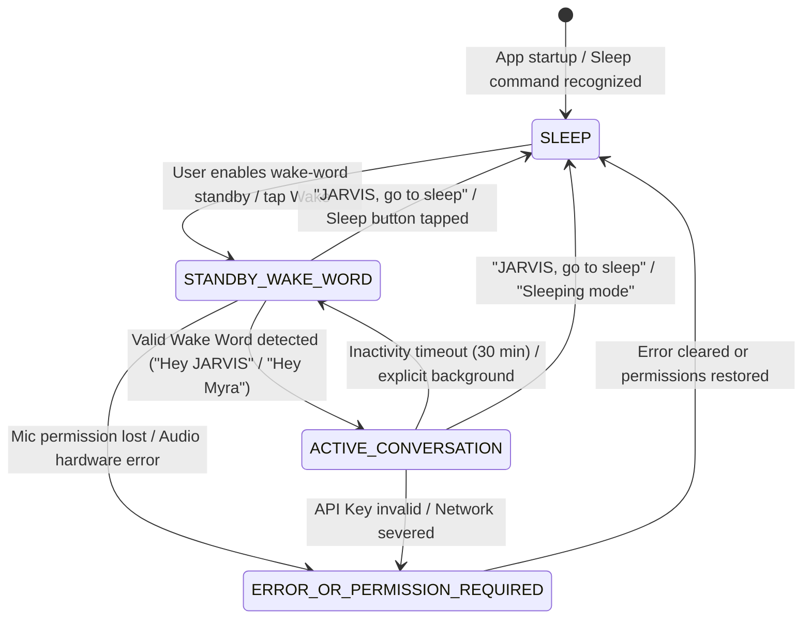

# JARVIS Voice, Wake-Word & Sleep State Machine Audit

**Generated Date:** November 9, 2026  
**Target Services:** `com.jarvis.assistant.background.JarvisConversationService`, `com.jarvis.assistant.audio.VoskModelManager`  
**Audio Pipeline:** `AudioRecorder` (16kHz PCM), `AudioPlayer` (24kHz AudioTrack), `GeminiLiveWebSocket`  
**Offline Wake Engine:** Vosk Android (`com.alphacephei:vosk-android:0.3.75`)  

---

## 1. Central State Machine Architecture

The voice and conversational lifecycle of JARVIS is governed by a central, explicit state machine:



### State Definitions & Operational Rules:

| State | Microphone Status | Network / Gemini Activity | Audio Playback | Permitted Transitions |
|---|---|---|---|---|
| **`SLEEP`** | **Strictly Stopped** (or low-power listener if user chose sleep-wake standby). | **ZERO network or Gemini calls**. Any inflight WebSocket requests cancelled immediately. | **Flushed and silenced**. All audio track resources idle. | -> `STANDBY_WAKE_WORD`<br>-> `ACTIVE_CONVERSATION` (manual UI tap) |
| **`STANDBY_WAKE_WORD`** | Open locally for **Vosk speech recognizer ONLY** (16kHz mono). | **ZERO cloud streaming**. Audio frames stay in local RAM for keyword matching; never uploaded. | Local wake chime only (`JarvisSoundEffects`). | -> `ACTIVE_CONVERSATION` (on wake word)<br>-> `SLEEP` (on command) |
| **`ACTIVE_CONVERSATION`** | Open for `AudioRecorder` (16kHz PCM). Streamed to Gemini Live. | **Active WebSocket live stream** to Gemini Live API (`wss://...`). Bidirectional audio. | `AudioPlayer` actively streaming 24kHz PCM from Gemini via `AudioTrack`. | -> `STANDBY_WAKE_WORD`<br>-> `SLEEP`<br>-> `ERROR_OR_PERMISSION_REQUIRED` |
| **`ERROR_OR_PERMISSION_REQUIRED`** | Stopped / released. | Disconnected. Displaying diagnostic banner/toast. | Silenced. | -> `SLEEP`<br>-> `STANDBY_WAKE_WORD` |

---

## 2. Wake-Word Engine Analysis & Repair

### Engine Technology: Vosk-Android
- **Library**: `com.alphacephei:vosk-android:0.3.75@aar` + `net.java.dev.jna:jna:5.13.0@aar`.
- **Acoustic & Language Model**: Packed locally in `app/src/main/assets/model-en-us` (unpacked to `context.filesDir/vosk-model`).
- **Speaker Recognition Model**: Packed locally in `app/src/main/assets/model-spk` (unpacked to `context.filesDir/vosk-spk-model`) for x-vector speaker cosine matching.
- **Offline / Local Guarantee**: Verified 100% offline. The Vosk native C/C++ engine runs via JNI, evaluating audio buffers directly in device memory without network sockets.

### Confirmed Defect: Missing "Hey Myra" Wake Word
In `JarvisConversationService.kt:3059`:
```kotlin
val grammar = "[\"jarvis\", \"hey jarvis\", \"hi jarvis\", \"hello jarvis\", \"ok jarvis\", \"okay jarvis\", \"wake up jarvis\", \"sun jarvis\", \"suno jarvis\", \"jarvis jarvis\", \"[unk]\"]"
```
And in `VALID_WAKE_PHRASES` (`JarvisConversationService.kt:3114`):
```kotlin
private val VALID_WAKE_PHRASES = setOf(
    "jarvis", "hey jarvis", "hi jarvis", "hello jarvis", "ok jarvis",
    "okay jarvis", "wake up jarvis", "sun jarvis", "suno jarvis", "jarvis jarvis"
)
```
**Defect**: The user requirement specifically mandates both **"Hey JARVIS"** and **"Hey Myra"**. "Hey Myra", "Myra", and "Hello Myra" were entirely omitted from the Vosk grammar and the validation set.

### Resolution:
1. Update grammar string to include:
   `"myra"`, `"hey myra"`, `"hi myra"`, `"hello myra"`, `"ok myra"`, `"suno myra"`
2. Update `VALID_WAKE_PHRASES` set to recognize Myra phrases.
3. Update persona greeting logic so waking via "Hey Myra" seamlessly personalizes the conversation.

---

## 3. Sleep Command & State Handling

### Supported Natural-Language Sleep Commands:
The user can trigger sleep with any of the following expressions in English, Hindi, or Hinglish:
- *"JARVIS, go to sleep."* / *"Go to sleep."*
- *"JARVIS, sleeping mode."* / *"Sleeping mode on."*
- *"Sleep mode"* / *"Sleep JARVIS"*
- *"So jao"* / *"Ab so jao"* / *"Aaram karo"*
- *"Enter standby mode"* / *"Take a break"*

### Exact Action Sequence upon Sleep Recognition:
1. **Immediate Abort of Conversational Stream**:
   - `GeminiLiveWebSocket` is immediately closed or paused.
   - Any incoming audio chunks from Gemini are discarded.
2. **Audio Flushing**:
   - `AudioPlayer.flush()` is called immediately to silence speaker output.
3. **Hardware Mic Release**:
   - `AudioRecorder.stopRecording()` releases the recording hardware buffer.
4. **Transition to SLEEP State**:
   - `_voiceState.value = JarvisVoiceState.SLEEP` is emitted.
   - Sound cue plays (`JarvisSoundEffects.playStandbySound()`).
5. **Standby Preference Control**:
   - If user enabled offline wake-word standby, the low-power local Vosk detector remains active to wake up upon "Hey JARVIS" or "Hey Myra".
   - If user requested complete sleep (mic off), microphone is completely released.

---

## 4. Privacy Boundaries: Local vs Cloud Audio

### Acoustic Reality Notice:
> [!IMPORTANT]
> A mobile device cannot acoustically detect an offline wake word like "Hey JARVIS" or "Hey Myra" without capturing microphone audio samples. 
> JARVIS handles this with strict, audited boundaries:

1. **In `STANDBY_WAKE_WORD`**:
   - Microphones capture 16kHz audio fed exclusively to the on-device Vosk neural model.
   - **No network traffic**: Audio frames never leave RAM; they are evaluated in a circular buffer and overwritten.
   - General conversation transcription is disabled; only the exact configured grammar tokens are scored.
2. **In `SLEEP`**:
   - Gemini API connection is completely closed. No queries are possible until wake word or manual tap.
3. **In `ACTIVE_CONVERSATION`**:
   - Mic audio streams to Gemini Live only while actively speaking with JARVIS.
   - Interruption detection stops playback within < 50ms of user speech.
